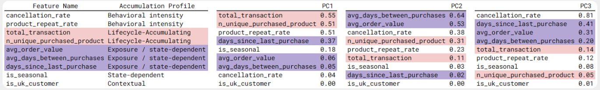
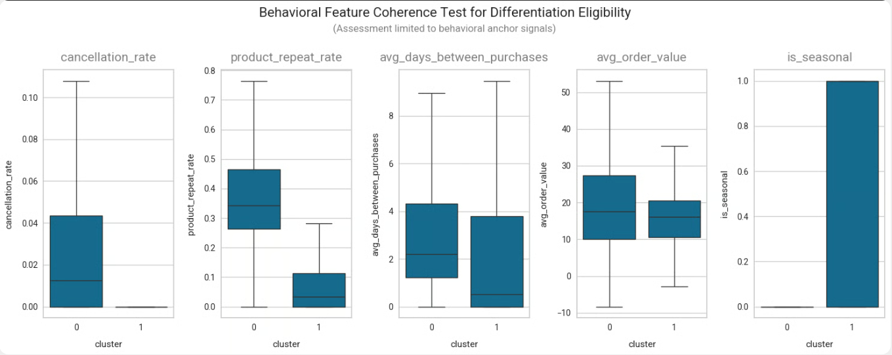

# Prioritization Analysis

> A behavior-driven Python and scikit-learn diagnostic that gates customer differentiation on proven behavioral evidence.

**Result:** No customers qualified for differentiated handling; Standardized and Minimal/Automated workflows are the enforced defaults. <br>
**Gate:** Differentiation requires behavior that separates naturally, stays stable, maps to a direct action, and carries low misclassification risk.

## The Decision

Customer operations run on limited human capacity. Differentiating treatment without a behavioral reason increases risk and wastes time, so the question is whether customer behavior warrants specialized handling under current resource constraints.

- Sending resources to the wrong customer is a material loss.
- Sticking to a standardized approach is the correct choice when evidence is weak.
- Inaction is an accepted, deliberate outcome when justification is absent.

**Decision:** Whether customer-facing behavior justifies any escalation to differentiated handling under finite execution capacity
**Scope:** The active customer base of a UK online retailer

**Objectives:**

- Test whether customer behavior forms distinct, stable profiles that justify differentiated handling
- Separate signals that can constrain effort from model outputs and abstract scores
- Define the conditions under which differentiation would create unacceptable misclassification risk


## What the Data Showed

Behavioral profiles were built from transactions and tested for natural separation, stability, direct action, and low risk.

### Dimensionality Reduction

*Assumption: Customer behavior forms distinct natural profiles that justify differentiated handling.*

PCA loadings were dominated by account lifecycle and exposure profiles. The first component combined transaction volume, product repetition, and product exposure, so older customers look different because they have more transactions over time, not because their behavior differs. Rhythm, efficiency, and stability did not remain distinct after reduction.

**Insight:** Dimensionality reduction produced artificial variance and was dropped as a decision input.



### Clustering

*Assumption: Customers separate into stable, actionable groups.*

Elbow diagnostics showed no clear breakpoint, and silhouette scores peaked at k=2 and declined, with k=3 and k=4 producing negative silhouette values. Core behavioral dimensions (purchase rhythm, repeat behavior, order value) overlapped across clusters, leaving within-cluster behavior mixed.

**Insight:** Adopting these segments would create a real risk of misclassification, so segmentation was rejected.




## Recommendation

**Differentiation beyond Standardized or Minimal/Automated handling is not justified.** Approved behavioral signals do not reduce the marginal waste of increased manual effort.

- Zero customers qualified for High-touch assignments.
- Minimal/Automated absorbs 66.9% of customers and Standardized the remaining 33.1%.
- Seasonality affects timing only and does not authorize additional effort.
- Some customers might benefit from manual help, but there is no reliable way to find them without guessing.


## Analysis Structure

Transactions are validated and corrected, translated into behavioral signals, then screened through decision gates. Only signals that can change execution effort survive the pipeline.

| Stage | Purpose |
| --- | --- |
| [`01_data_cleaning.ipynb`](notebooks/01_data_cleaning.ipynb) | Validate transactional integrity and structural consistency; correct issues that materially affect behavioral interpretation |
| [`02_feature_engineering.ipynb`](notebooks/02_feature_engineering.ipynb) | Translate transactions into customer-level behavioral signals encoding timing, persistence, and efficiency |
| [`03_dimensionality_reduction.ipynb`](notebooks/03_dimensionality_reduction.ipynb) | Test variance-based transformations against the scaled base features; reject reduction that collapses behavioral structure |
| [`04_clustering_analysis.ipynb`](notebooks/04_clustering_analysis.ipynb) | Assess whether behavioral features support defensible segmentation; reject clusters without clear separation |
| [`05_prioritization_analysis.ipynb`](notebooks/05_prioritization_analysis.ipynb) | Map behavioral differences to execution-relevant treatment constraints; block differentiation where signals do not justify action |

## Repository Structure

```
├── data/
│   ├── raw/                                   # original source data
│   ├── cleaned/                               # validated and cleaned datasets
│   ├── preprocessed/                          # feature-engineered datasets
│   └── final/                                 # decision ready customer behavior profiles
├── docs/
│   ├── analysis/
│   │   └── decision_gates_and_enforcement.md  # source-of-truth decision framework
│   ├── data_handling/
│   │   └── data_handling_log.md               # preprocessing and data handling logs
│   ├── feature_engineering/
│   │   ├── feature_definitions.md             # feature definitions
│   │   └── feature_rationale.md               # feature design rationale
│   └── raw/
│       └── customer_raw_dictionary.md         # source data documentation
├── notebooks/
│   ├── 01_data_cleaning.ipynb                 # data validation and cleaning
│   ├── 02_feature_engineering.ipynb           # behavioral feature construction
│   ├── 03_dimensionality_reduction.ipynb      # structure viability testing
│   ├── 04_clustering_analysis.ipynb           # segmentation diagnostics
│   └── 05_prioritization_analysis.ipynb       # decision enforcement and outcome
├── resources/
│   └── images/                                # exported chart evidence used in this README
└── src/                                       # shared plotting and assessment utilities
```

## Reproducing the Analysis

Requires Python with Jupyter, pandas, scikit-learn, and matplotlib.

1. Place [`data/raw/Online Retail.xlsx`](data/raw/Online%20Retail.xlsx) in [`data/raw/`](data/raw/).
2. Run the notebooks in [`notebooks/`](notebooks/) in order: `01` through `05`.
3. Cleaned data lands in [`data/cleaned/customer_cleaned.parquet`](data/cleaned/customer_cleaned.parquet), engineered features in [`data/preprocessed/`](data/preprocessed/), and the decision-ready profile in [`data/final/customer_behavior_profile.parquet`](data/final/customer_behavior_profile.parquet).

## Documentation Index

| Document | Covers |
| --- | --- |
| [`decision_gates_and_enforcement.md`](docs/analysis/decision_gates_and_enforcement.md) | Decision gates, approved signals, treatment bands, and enforcement rules |
| [`data_handling_log.md`](docs/data_handling/data_handling_log.md) | Data quality issues, corrections, and field handling decisions |
| [`feature_definitions.md`](docs/feature_engineering/feature_definitions.md) | Field-level definitions for engineered behavioral features |
| [`feature_rationale.md`](docs/feature_engineering/feature_rationale.md) | Behavioral justification for each engineered feature |
| [`customer_raw_dictionary.md`](docs/raw/customer_raw_dictionary.md) | Source data documentation for the raw dataset |

## Scope Boundaries

This project intentionally does **not**:

- Rank or score customers
- Force segmentation where behavior does not support it
- Use model artifacts as decision inputs
- Optimize execution tactics or staffing plans
- Recommend engagement strategies absent defensible eligibility

Its purpose is to determine whether prioritization is justified at all, and to constrain execution effort accordingly.
